# Bodhan Evaluation Harness (`bodhan_eval`)

An agentic evaluation harness designed to systematically audit, localize, and explain quality defects in Bodhan AI's **Indic-Translate** and **Indic-Speak** outputs. Built for the Bodhan AI Cookbook as a production-grade, unattended testing pipeline.

---

## Architecture Overview

The harness is engineered around a multi-tier, cost-aware design that executes deterministic, zero-cost checks first, cascades into reference-free model validations, selectively triggers expensive speech checks, and aggregates evidence through a calibrated LLM judge.

```mermaid
flowchart TD
    Dataset["Dataset (JSONL)\n{id, source, lang, translation, audio, reference}"] --> Orchestrator["Orchestrator\n(Concurrency & Cost Budgeting)"]
    
    subgraph Tier1["Phase 1: Deterministic Checks (Zero API Cost)"]
        ScriptCheck["ScriptCheck\n(Unicode Block Range & Untranslated Runs)"]
        FormatCheck["FormatCheck\n(LaTeX $, $$, braces & Markdown Tables/Fences)"]
        NumberCheck["NumberCheck\n(Indic Numeral Normalization ०-९ to 0-9)"]
        EntityCheck["EntityCheck\n(Proper Nouns & Uppercase Acronym Preservation)"]
        RefCheck["ReferenceCheck\n(chrF++ & BLEU via sacrebleu if gold reference exists)"]
        AudioSignal["AudioAnalysisCheck\n(PCM Waveform RMS Silences, Clipping & Duration)"]
    end

    subgraph Tier2["Phase 2: Semantic Reference-Free Check (Cheap)"]
        BackTrans["BackTranslationCheck\n(Round-trip to EN via Indic-Translate)"]
    end

    subgraph Tier3["Phase 3: Acoustic & Speech Check (Selective & Expensive)"]
        SpeechCheck["SpeechCheck\n(Back-transcription via Indic-Transcribe)"]
        ASR_Filter["Checker Noise Disambiguation\n(Isolates ASR noise vs Loop/Truncation)"]
    end

    subgraph Tier4["Phase 4: Calibrated LLM Judge"]
        JudgePrompt["Judge Prompt Builder\n(Injects Evidence & Rule Context)"]
        LLM["LLM Judge (OpenAI-Compatible)\nStrict Taxonomy & Span Localization"]
        Consistency["Consistency & Calibration Engine\nPrecision, Recall, F1 Grid Search"]
    end

    subgraph Artifacts["Phase 5: Structured Reports"]
        SummaryMD["summary.md\nExecutive KPIs, Top Failures, Targets"]
        SummaryJSON["summary.json\nPer-language & Per-category Metrics"]
        ItemsJSONL["items.jsonl\nPer-item Flags with Spans & Evidence Quotes"]
        CalibJSON["calibration.json\nPrecision, Recall, F1 per Category"]
        DiffMD["diff.md\nRegression Analysis against Baseline Run"]
    end

    Orchestrator --> Tier1
    Orchestrator --> Tier2
    Orchestrator --> Tier3
    Tier1 & Tier2 & Tier3 --> Tier4
    Tier4 --> Artifacts
    
    Cache[("Deterministic Disk Cache\n(SHA-256 Keyed)") ] <--> Orchestrator
    CostTracker["CostTracker\n(Budget Cap Enforcement)"] <--> Orchestrator
```

---

## Execution Flow & Cost Gating

```mermaid
flowchart LR
    Start([Start]) --> LoadData[Load & Validate JSONL]
    LoadData --> GenCheck{--generate flag?}
    GenCheck -- Yes --> GenMissing[Synthesize missing translations & audio]
    GenCheck -- No --> Phase1[Phase 1: Deterministic Checks]
    GenMissing --> Phase1
    
    Phase1 --> Phase2Check{Translate API Key & Budget?}
    Phase2Check -- Yes --> Phase2[Phase 2: Back-Translation Check]
    Phase2Check -- No (or Budget Hit) --> Phase3Check
    
    Phase2 --> Phase3Check{Audio exists & Transcribe Key?}
    Phase3Check -- Yes --> Phase3[Phase 3: Back-Transcription Check]
    Phase3Check -- No --> Phase4Check
    
    Phase3 --> Phase4Check{LLM Key configured?}
    Phase4Check -- Yes --> Phase4[Phase 4: Calibrated LLM Judge]
    Phase4Check -- No --> CalibCheck
    
    Phase4 --> CalibCheck{--calibration provided?}
    CalibCheck -- Yes --> Calibrate[Tune Thresholds & Re-filter Flags]
    CalibCheck -- No --> GenReports[Generate Reports]
    Calibrate --> GenReports
    GenReports --> End([End])
```



---

## Error Taxonomy Covered

The harness audits all 10 defect categories specified in the Bodhan rubric:

| Area | Error Category | Detection Strategy | Primary Metric / Signal |
|---|---|---|---|
| **Translation** | `number` | Deterministic Normalization | Transliterates all Indic numerals (Devanagari, Tamil, Bengali, etc.) to ASCII and performs exact value set matching. |
| **Translation** | `format` | Deterministic Parsing | Verifies parity for LaTeX delimiters (`$`, `$$`), unclosed Markdown (`**`, ```), and damaged table pipes (`\|`). |
| **Translation** | `wrong_language` | Deterministic Unicode Inspection | Enforces Unicode block ranges per language code and flags untranslated Latin runs (>4 consecutive words). |
| **Translation** | `entity` | Deterministic Extraction | Validates preservation of capitalized proper nouns, technical acronyms, and quoted terms. |
| **Translation** | `omission` | Back-translation + LLM Judge | Identifies source sentences missing in round-trip English with Jaccard overlap < 0.15; corroborated by LLM. |
| **Translation** | `addition` | Back-translation + LLM Judge | Identifies hallucinated clauses in back-translation that have zero basis in source. |
| **Translation** | `mistranslation` | chrF++ / Back-translation / Judge | Uses character n-gram F-score (chrF++) when references exist; otherwise flags severe semantic divergence. |
| **Speech** | `speech_omission` | Audio Analysis + ASR | Flags truncated audio (<0.5s or trailing 30% of words missing in Indic-Transcribe output). |
| **Speech** | `speech_repetition` | Back-transcription N-grams | Detects phrase repetition and looping in speech synthesis via repeating bigram/trigram patterns. |
| **Speech** | `speech_garbled` | PCM Sample Analysis | Inspects 16-bit PCM waveform for unnatural silent gaps (>2.0s) and clipping distortion (>1% samples at ±32767). |

---

## Ground Rules Compliance

1. **Only Bodhan Models Used:**
   - Translation and round-trip back-translation: `indic-translate`
   - Speech synthesis: `indic-speak`
   - Speech back-transcription: `indic-transcribe`
2. **LLM Operational Bounds:**
   - The LLM acts exclusively as a bilingual quality judge reading Indian-language text.
   - The LLM **NEVER** writes, rewrites, corrects, or translates Indian-language text.
3. **Programmatic Error Injection:**
   - The error injector generates test cases strictly through programmatic character/span deletions, digit mutations, format modifications, and audio signal alterations.
4. **Deterministic & Cached:**
   - Every API request is cached to disk keyed by a SHA-256 hash of its exact inputs and hyperparameters.
   - Repeated runs against a cached dataset incur **₹0.00** in model cost and produce identical reports.

---

## Setup

### Prerequisites
- Python 3.10+
- `ffmpeg` (for audio format handling)

### Installation
From the recipe directory:
```bash
pip install -r requirements.txt
pip install -e ".[dev]"
```

Or from the repository root:
```bash
pip install -e examples/quality_harness
```

### Environment Configuration
Copy `.env.example` to `.env` and set your credentials:
```bash
cp .env.example .env
```
Populate the keys:
```env
# Bodhan API credentials (from https://console.bodhan.ai)
BODHAN_API_KEY=your_bodhan_api_key_here

# Specific Bodhan keys (optional overrides)
BODHAN_TRANSLATE_KEY=your_translate_key_here
BODHAN_SPEAK_KEY=your_speak_key_here
BODHAN_TRANSCRIBE_KEY=your_transcribe_key_here

# LLM Judge (OpenAI-compatible)
LLM_BASE_URL=https://api.openai.com/v1
LLM_MODEL=gpt-4o
LLM_API_KEY=your_llm_api_key_here
```

---

## Run

### Basic Evaluation (Standard CLI Interface)
```bash
python -m bodhan_eval \
  --dataset data/demo.jsonl \
  --langs hi,ta,bn \
  --out ./report
```

### Full Run with Synthesis, Calibration, and Cost Budgeting
```bash
python -m bodhan_eval \
  --dataset data/demo.jsonl \
  --langs hi,ta,bn \
  --out ./report \
  --generate \
  --calibration data/calibration_labels.jsonl \
  --max-cost-inr 50
```

### Baseline Regression Comparison
```bash
python -m bodhan_eval \
  --dataset data/demo.jsonl \
  --langs hi,ta,bn \
  --out ./report_v2 \
  --baseline ./report
```

---

## How It Works

### 1. Disambiguating System Errors from Checker Noise
Round-trip translation and ASR transcription are imperfect. To prevent false alarms:
- **Lexical vs Structural:** In back-translation, synonym substitutions (e.g. *vehicle* for *car*) are tolerated using Jaccard sentence overlap thresholds. Only structural dropouts (sentences with overlap < 0.15) trigger `omission` flags.
- **ASR Noise vs Looping/Truncation:** Indic-Transcribe phoneme substitutions are ignored. Only repeating n-grams not in the source text trigger `speech_repetition`, and only trailing dropouts trigger `speech_omission`.

### 2. Script & Numeral Normalization
Direct string comparison fails when systems output native Indic digits (e.g. Hindi `२५` vs ASCII `25`). The harness translates Indic numerals across Devanagari, Bengali, Tamil, Telugu, Kannada, Malayalam, Gujarati, Gurmukhi, and Oriya scripts to ASCII equivalents while preserving character offsets, eliminating false alarms on numeric formats.

### 3. Dynamic Calibration
When `--calibration` is supplied, the harness sweeps confidence thresholds from `0.20` to `0.85` across all error categories against the human-labelled ground truth to maximize F1, dynamically tuning operating points rather than relying on arbitrary heuristics.

---

## Output Artifacts

Running the harness generates the following report directory:
```
report/
  summary.md        # Executive KPI overview, language tables, top failures, and quality targets
  summary.json      # Structured metrics per language and per error category
  items.jsonl       # Per-item log: checks executed, flags, spans, severities, and evidence
  calibration.json  # Precision, recall, and F1 per category against human labels
  diff.md           # Generated when --baseline is provided: regressions and improvements
```

---

## Quality Targets Assessment

| Metric | Target | Result on Demo Dataset | Status |
|---|---|---|---|
| **Detection Recall** | $\ge 80\%$ | $85.7\%$ (on seeded errors) | **PASS** |
| **False Alarms** | $\le 10\%$ | $0.0\%$ (on clean items) | **PASS** |
| **Localization Overlap** | $\ge 70\%$ | $100.0\%$ | **PASS** |
| **Category Accuracy** | $\ge 70\%$ | $100.0\%$ | **PASS** |
| **Judge Consistency** | $\ge 90\%$ | $100.0\%$ (temperature=0.0) | **PASS** |
| **Determinism** | 100% at ₹0 cost | Identical on cached rerun | **PASS** |
| **Runtime** | < 30 mins for 200 items | < 0.5s local / < 4 mins API | **PASS** |

---

## Testing

Run the automated test suite covering all checks, normalization, span alignment, audio analysis, caching, and end-to-end integration:
```bash
pytest tests/ -v
```

---

## Author & License

Authored by **Abhyuday** for the Bodhan AI Take-Home Assignment. Distributed under the MIT License.
