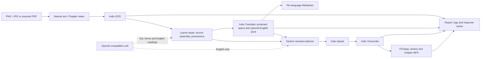
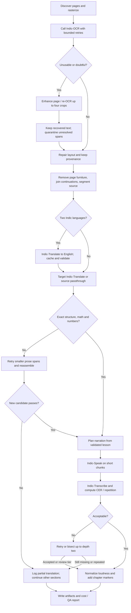

# Design

## Architecture

## Workflow and recovery

## Where the LLM decides

| Decision | Data and guardrail | Fallback |
| --- | --- | --- |
| OCR layout and doubt | OCR block IDs, excerpts, boxes and flags; order must be a full permutation. Margin notes must be geometrically marginal or already labeled as a note/sidebar. | Detected gutter with lane ordering or provider order; deterministic corruption checks. |
| Language ambiguity | Choose the label for texts sharing a script, e.g. Hindi/Marathi or Bengali/Assamese. | Script default; the CLI accepts an explicit source hint. |
| Technical glossary | Rank exact, repeated English OCR spans. Bodhan translates the selected phrases. | Supplied glossary or context-aware model translation without substitution. |
| Narration | Draft only English readings of tables, complex formulas, and explicit figure relationships. Check numeric values and formula labels. | Common math verbalizer, row-by-row table reading, and a caption or a logged figure reference. Never ask the agent to fill in Indian-language text. |

The LLM sees OCR output as quoted evidence rather than page instructions. It never receives keys, never calls tools, and cannot inject blocks into the source. Every line in an Indic-language Markdown answer comes from Indic-OCR, Indic-Translate, supplied glossary data, or reinserted literals. Synthetic headers, footers and audit comments are deterministic metadata.

## Three narration examples

- **Table:** A table with Pool, Morning and Evening headings and a row of North, 12 and 19 may become “For the north pool, the morning value is 12 and the evening value is 19.” When a draft drops a value from a small table, the row-by-row fallback reads both cells.
- **Equation:** `$x+4=9$` becomes “x plus 4 equals 9.” The original LaTeX remains in Markdown. Complex expressions use a checked English plan; unknown operations without a valid plan are recorded.
- **Figure:** If a caption and adjacent paragraph explicitly state that a transversal crosses two parallel lines, the narration describes that relationship without guessing unseen labels or measurements. A figure with no usable evidence is flagged and linked in Markdown.

A list is read in order, retaining explicit item numbers. Boxed educational material stays in the source; isolated handwriting is recorded as a separate annotation when identifiable. Section boundaries use OCR headings and a length cap and never depend on a particular chapter or title.

## QA and accounting

The run is organized by page, language, section and source block. The terminal emits JSON lines without authorization values. `report.json` aggregates wire calls, retry outcomes, estimated INR and coverage. Source block IDs and line spans are carried through to narration chunks. The chunk history includes actual submitted text and matching transcript, and timestamps on accepted chunks are relative to their section.

Each successful API response is cached by operation, model request, endpoint, bytes and QA retry variant. A striped lock coalesces identical work within a run; a bounded semaphore covers all network calls. HTTP retries use exponential backoff with jitter and a bounded `Retry-After`; validation retries have their own caps. Page crop repair and TTS retries are accounted for separately from transport errors.

CER is calculated after NFKC normalization, case folding, Unicode decimal normalization, and removing punctuation/spacing; script marks survive. Acceptance requires CER ≤0.26 and no strong repetition or length signal. If retries or splitting cannot improve a noncatastrophic result, clips with CER ≤0.48 may be kept with a review flag. Bad or missing clips stay visible in coverage and contribute to a partial result. The section measure weights accepted chunks by reference characters. FFmpeg performs two-pass loudness normalization where measurements allow, checks the encoded MP3, and FFprobe verifies embedded chapters.
