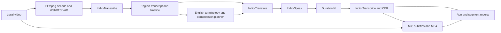
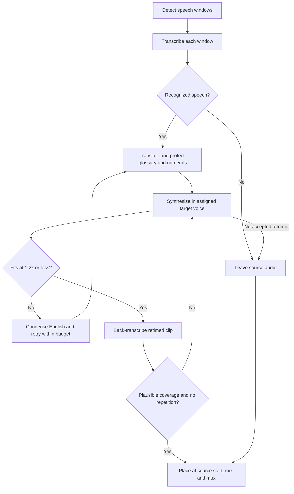

# Design

## Architecture

## Workflow

## Decisions and safeguards

| Decision | Method | Recovery |
|---|---|---|
| Speech windows | WebRTC VAD on 30 ms PCM frames with an adaptive energy floor. Merge nearby voiced frames and cut long runs at an energy dip. | Leave non-speech unvoiced. Log missing recognition or provider errors. |
| Terminology | LLM returns exact English spans from the source. YAML can supply approved target terms. Validate numerals, script, markers and named terms after Indic-Translate. | Retry with protected markers. Avoid dubbing a failed result. |
| Duration | Remove leading and trailing quiet samples. Allow up to 550 ms of following silence if it is free, then use pitch-preserving FFmpeg `atempo`. | At more than 1.2×, request shorter English, verify anchored facts, then retranslate. A lower-risk filler removal can work without a planner. |
| Narration quality | Back-transcribe each retimed clip. Compare normalized Unicode CER, length and repeated trigrams. | Try at most three variants. Keep the lowest-CER plausible clip and flag review if it falls between 0.26 and 0.58 CER. Reject clear repetitions or losses. |
| Final audio | Place each clip on the source sample timeline. Fade the original center channel under replaced speech, keep side information, and cap peaks. | Keep the original audio for any skipped window. Record duration and loudness misses. |

Run-level request logs identify phase, language, segment, outcome, retry, latency and estimated billing. A shared semaphore limits outbound calls. The response cache keys on the full model payload and input bytes, excluding keys. Resumed runs can reuse paid source, translation and speech calls. An optional budget estimates committed spend and in-flight reservations. Google or other LLM token use is tracked separately.

Timestamps are measured in audio clock milliseconds. Duration drift is checked using FFprobe on the finished media. The audio lane stays aligned even when a segment is skipped. Visual lip synchronization and true source separation are not estimated by the report.
